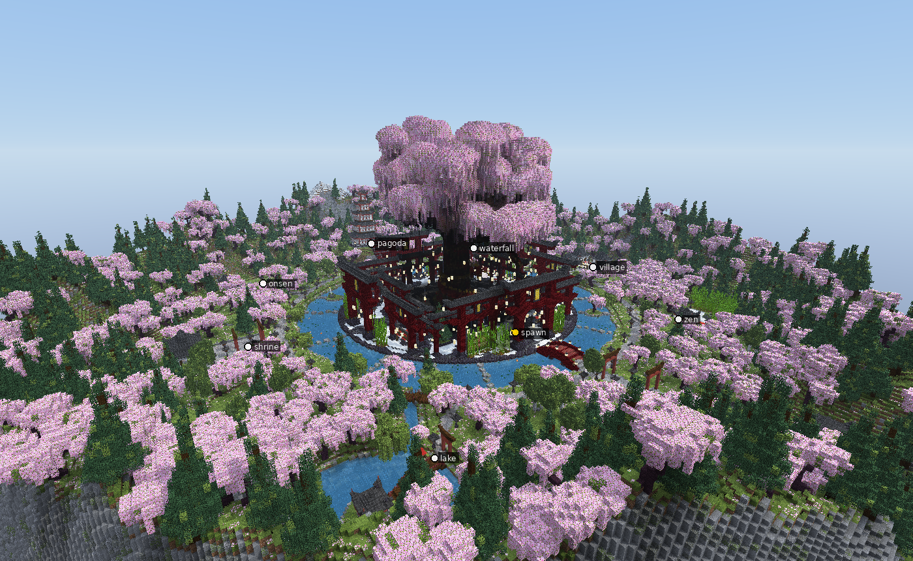
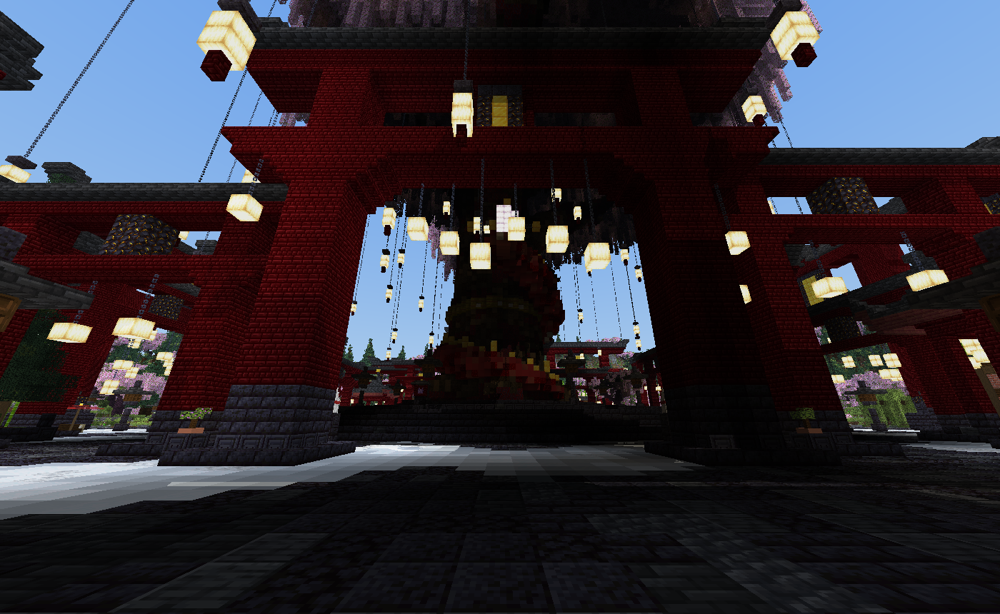
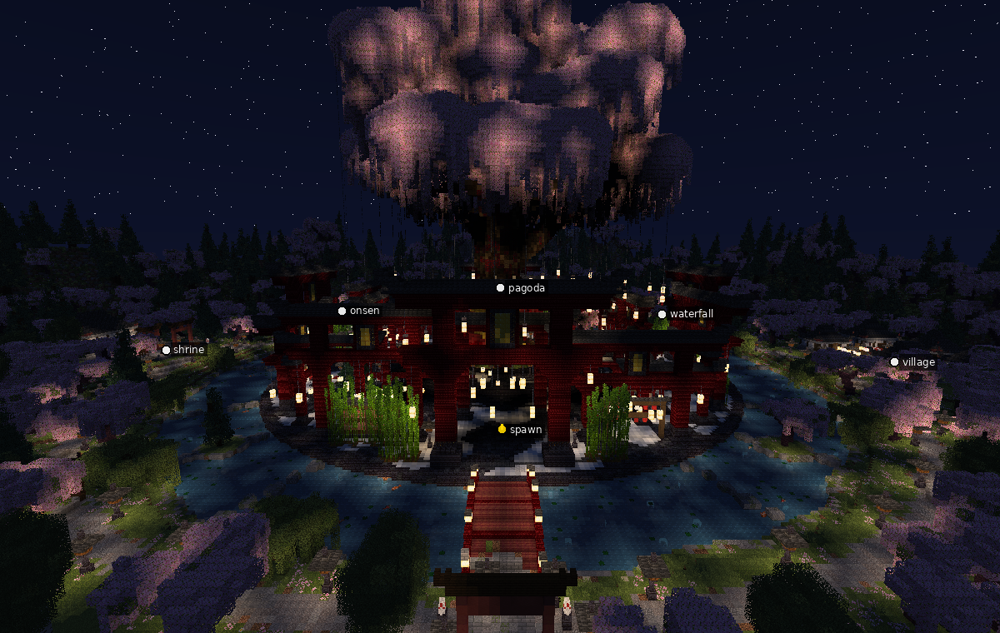

# Sakura Grand — спавн в японском стиле

Minecraft 1.21.4, размер 433×132×433, без голограмм.

## Что внутри

- **Главная площадь** радиусом 78 блоков: тёмный пол с белыми пятнами, в центре приподнятый помост и гигантская сакура (крона до y=183).
- **Тории и рамы**: четыре больших тории высотой 34 блока на осях, перед ними тории поменьше, вокруг ряды рам разной высоты с крышами из глубинного сланца, фонари на цепях.
- **Пруд** кольцом вокруг площади: 14 переправ из камней, по которым надо прыгать, 4 островка, два красных арочных моста (север и юг), кувшинки, подсветка дна.
- **Долина** до 216 блоков от центра: пагода на холме с лестницей из торий, чайная деревня, святилище, дзен-сад с бамбуком, озеро со святилищем на острове и торий в воде, онсэн, водопад, аллея с воротами на юге, лес из сакур и сосен.
- **3D-модели** (354 display-сущности + скульптура из блоков): дракон вокруг ствола с жемчужиной, колокол, стойки бумажных фонарей, статуи кицунэ, зонты со скамейками, бонсай, карпы в пруду, стойки с катанами, гигантская катана в камне, мини-святилище.

## Как вставить

1. Скопируй `sakura_grand.schem` в `plugins/WorldEdit/schematics/` (или `plugins/FastAsyncWorldEdit/schematics/`).
2. Встань туда, где должна быть точка спавна (якорь — место появления игрока на площади, лицом на север).
3. `//schem load sakura_grand`, затем `//paste -a -e -b`.
   - `-e` обязателен: без него не вставятся 3D-модели.
   - `-b` переносит биом cherry_grove.
4. Вода у водопада начнёт течь после вставки — так и задумано.

Точки (относительно якоря 0,65,56 в координатах постройки): `spawn` (0,65,56), `pagoda` (0,82,-134), `village` (141,68,6), `shrine` (-128,70,-4), `zen` (89,67,104), `lake` (-92,·,112), `onsen` (-100,70,-108), `waterfall` (104,·,-113).

## Исходники

`scripts/` — шаги сборки для BuildMCP по порядку (шаги 10 и 11 лежат в `step10.py` и `step11.py`).
