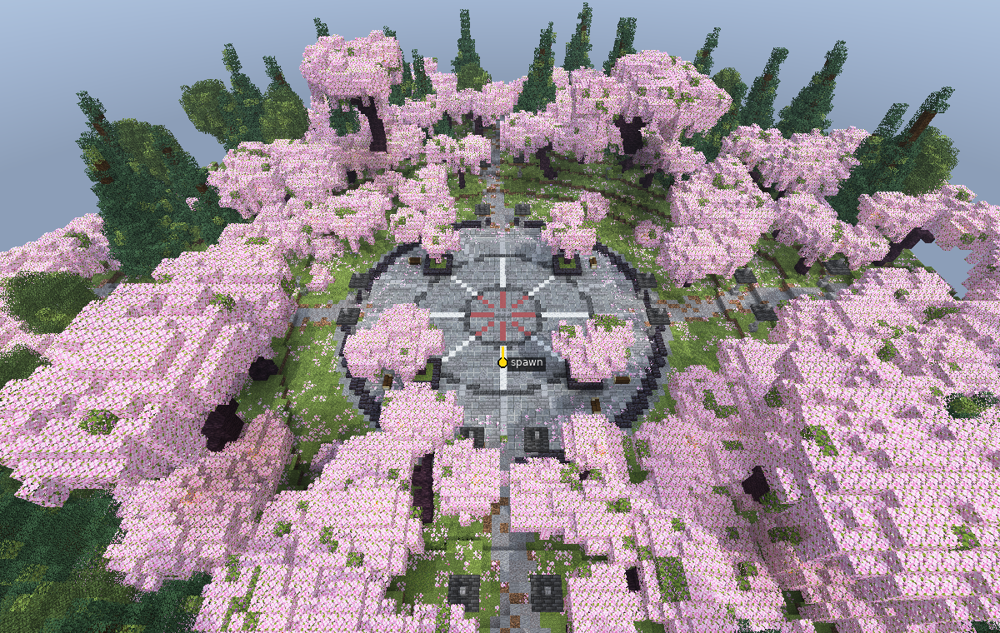
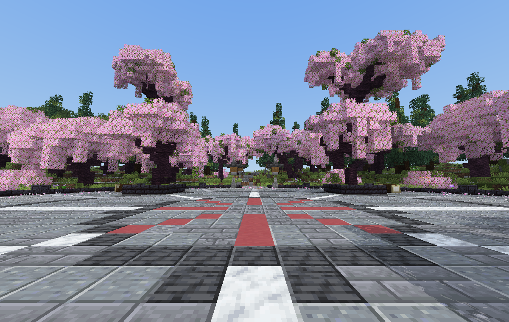

# Sakura Simple — простой спавн

Minecraft 1.21.4, 155×42×146. Плоская каменная площадь радиусом 26 блоков, вокруг кольцо сакур (ближе к краю сосны и берёзы), луг с цветами и лепестками, четыре дорожки, каменные фонари, скамейки. Без построек, голограмм и 3D-моделей.

## Как вставить

1. `sakura_simple.schem` → `plugins/WorldEdit/schematics/` (или папка FAWE).
2. Встань там, где должен появляться игрок (точка спавна на площади, лицом на север).
3. `//schem load sakura_simple`, затем `//paste -a -b`.

Низ схематики — каменная «подушка» до 9 блоков под площадью. Вставляй на уровне земли, чтобы её не было видно.
